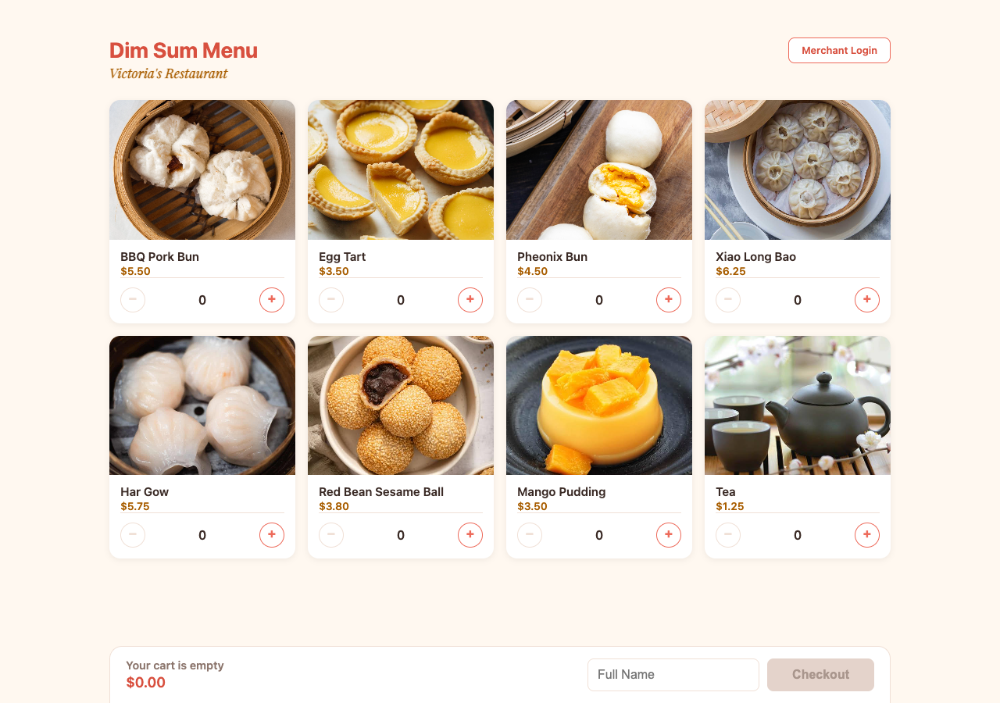
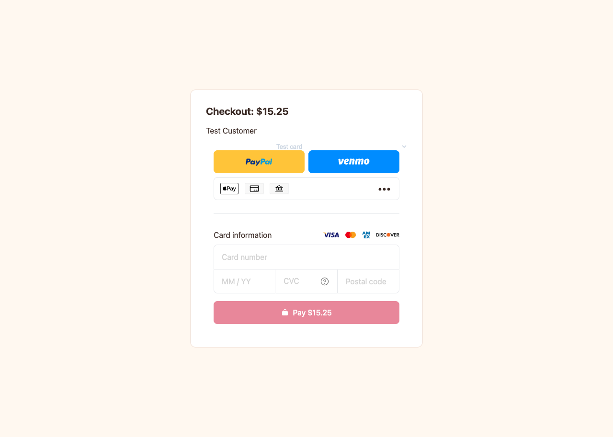
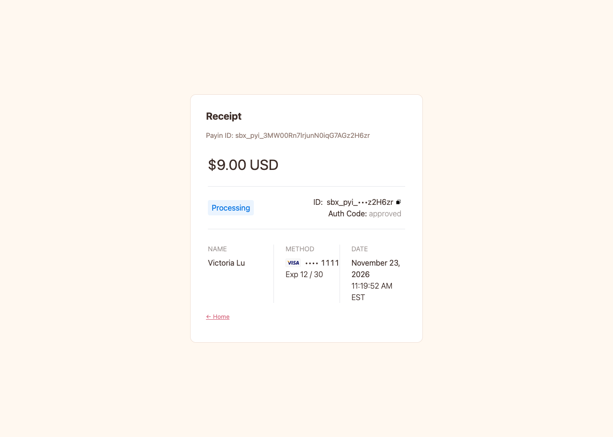
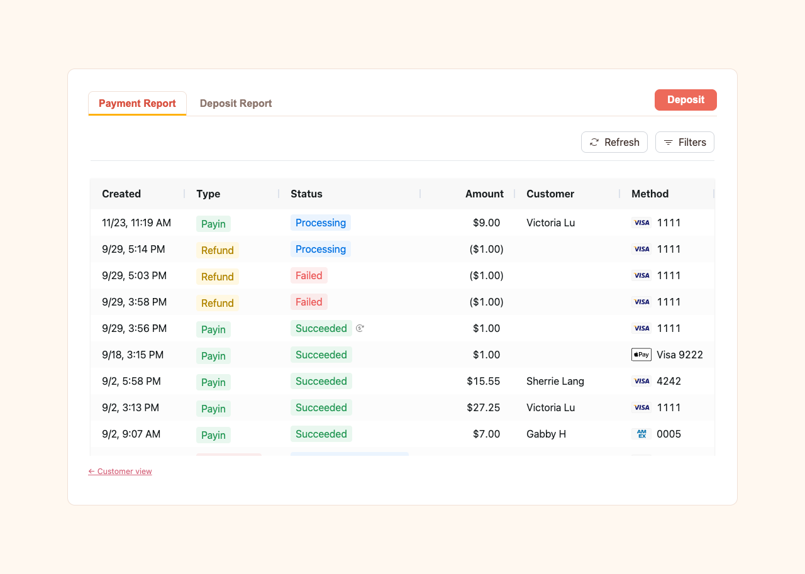

# 🥟 Victoria's Restaurant — Dim Sum Ordering Demo

A small dim sum ordering site built to showcase [Rainforest Payments](https://rainforestpay.com) embedded components — checkout, receipts, and merchant reporting — wired up end to end in a real Node/Express app.

Order dumplings, pay through an embedded payment form (card, ACH, Apple Pay, PayPal, Venmo), get a receipt, then flip over to the merchant side to watch the payment and deposit reports update live.

## ✨ What's inside

| Page | Route | What it shows |
|---|---|---|
| Menu | `/index.html` | Browse the dim sum menu, add items to a cart, check out |
| Checkout | `/checkout.html` | Embedded Rainforest **payment component** collects card details and pays |
| Receipt | `/receipt.html` | Embedded Rainforest **receipt component** for the completed order |
| Merchant Report | `/report.html` | Embedded **payment report** + **deposit report** components, with a "simulate deposit" action |

The Express server (`server.js`) never talks to Rainforest directly from the browser — it brokers short-lived, scoped **session keys** through `/api/*` routes (`src/routes/api.js`), and each page mounts the matching Rainforest web component with that key.

## 🧰 Tech stack

- **Node.js** + **Express** — static file serving and a thin API layer
- Plain **HTML/CSS/JS** on the frontend (`public/`) — no framework, no build step
- [Rainforest Payments](https://rainforestpay.com) sandbox components (`sandbox.payment.js`, `sandbox.merchant.js`) loaded straight from Rainforest's CDN

## 🚀 Getting started

### 1. Install dependencies

```bash
npm install
```

### 2. Get sandbox credentials

You need a **Rainforest sandbox account**. Rainforest sets these up for platforms; there's no public self-serve signup, so if you don't have one, this app won't run for you (see [Trying it without credentials](#-trying-it-without-credentials)).

With an account, sign in to the sandbox Platform Portal at **https://platform.sandbox.rainforestpay.com** and collect:

- **API key** → open the **API keys** page and create a key. Sandbox keys start with `sbx_apikey_`. Copy it straight into `.env`; don't paste it into chat, tickets, or code.
- **Merchant ID** → pick the sandbox merchant you want orders charged to and copy its ID from the **Merchants** page. (Once a test payment exists, it also shows in the **Merchant ID** column of the Payments report.)

Sandbox payments move no real money. Use Rainforest's [test cards](https://docs.rainforestpay.com/docs/test-accounts-and-cards) at checkout.

### 3. Configure environment

Create a `.env` file in the project root (it's gitignored — never commit it):

```bash
RAINFOREST_API_KEY=your_sandbox_api_key
RAINFOREST_MERCHANT_ID=your_merchant_id
RAINFOREST_BASE_URL=https://api.sandbox.rainforestpay.com
```

| Variable | Required | Notes |
|---|---|---|
| `RAINFOREST_API_KEY` | yes | Sandbox API key. Only used server-side. |
| `RAINFOREST_MERCHANT_ID` | yes | Merchant that orders are charged to and reports are scoped to. |
| `RAINFOREST_BASE_URL` | yes | Keep this on the **sandbox** API — the pages load Rainforest's sandbox components. |
| `PORT` | no | Defaults to `3000`. |

### 4. Run it

Requires Node.js 18+ (the server uses the built-in `fetch`).

```bash
npm start       # node server.js
# or
npm run dev      # node --watch server.js, restarts on change
```

Then open **http://localhost:3000** 🎉

## 👀 Trying it without credentials

The app needs a Rainforest sandbox API key on the server, so someone without a sandbox account can't run it locally. Don't share your API key to get around this: unless you restrict it, an API key can act on your whole sandbox platform, not just this demo merchant.

To show the demo to someone without an account, share the screenshots below or a screen recording of the flow.

| Menu | Checkout | Receipt |
|---|---|---|
|  |  |  |

**Merchant report** (all sandbox test data)



## 🗂️ Project layout

```
server.js                  # Express app entrypoint
src/
  rainforestClient.js       # Thin fetch wrapper around the Rainforest API
  routes/api.js              # Routes that mint payin configs & session keys
public/
  index.html                 # Menu / cart
  checkout.html               # Embedded payment component
  receipt.html                 # Embedded receipt component
  report.html                   # Embedded merchant report components
  css/style.css                  # Shared styling
  js/                              # Per-page frontend logic
```

## 🔌 API routes

All routes live in `src/routes/api.js` and call Rainforest with the server's API key.

| Method | Route | Purpose |
|---|---|---|
| `POST` | `/api/payin-config` | Creates a payin config for the order. Body: `{ amount, customerName? }`, `amount` in dollars. |
| `POST` | `/api/session/payment` | Session key for the payment component (scoped to the merchant). |
| `GET` | `/api/session/receipt?payin_id=…` | Session key for the receipt component (scoped to one payin). |
| `POST` | `/api/session/report` | Session key for the payment report component. |
| `POST` | `/api/session/deposit-report` | Session key for the deposit report component. |
| `POST` | `/api/simulate-deposit` | Asks the sandbox to simulate a deposit for the merchant. |

## 🔐 A note on security

Session keys are scoped (e.g. `group#payment_component`, constrained to a specific `payin_id` or `merchant_id`) and short-lived (1 hour TTL). The Rainforest API key itself never leaves the server — only these narrow session keys are handed to the browser.

This is a **sandbox demo**, not a production integration. Known shortcuts:

- **The browser sets the charge amount.** The cart total is passed to `/checkout.html?amount=…` and sent straight to `/api/payin-config`, so anyone can edit the URL and pay a different amount. A real integration would compute the total on the server from item IDs and server-side prices.
- **Dollars are converted to cents with floating-point math** (`Math.round(amount * 100)`). Fine for a demo; real code should keep money in integer cents end to end.
- **No auth on the API routes.** Anyone who can reach the server can mint report session keys or simulate deposits for the configured merchant.
- **No automated tests.**

## 🩺 Troubleshooting

- **`no api key`** (in the server log or the checkout banner) — `RAINFOREST_API_KEY` isn't set. Check that `.env` exists in the project root.
- **Requests fail with a URL like `undefined/sessions`** — `RAINFOREST_BASE_URL` isn't set.
- **Components never render** — open the browser console; the pages load `static.rainforestpay.com/sandbox.*.js`, so you need network access to Rainforest's CDN.
